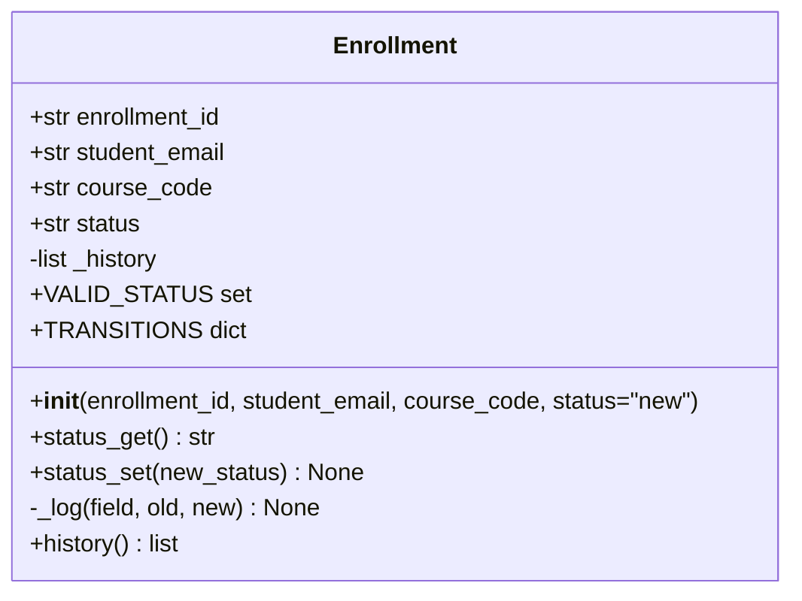

# Диаграмма класса Enrollment (Этап 6)

## Объяснение по-человечески

- **Что открыто снаружи.** Номер заявки, почта студента и код курса задаются
  при создании и дальше просто читаются. Статус читается как обычное поле
  (`ticket.status`), но это `property`: на каждое присваивание запускается
  проверка.
- **Что закрыто.** Журнал `_history` и сам `_status` начинаются с подчёркивания -
  так в Python помечают внутренние поля. Записать в журнал напрямую снаружи
  нельзя: есть только приватный `_log`, который вызывает сам класс.
- **Проверка переходов.** Словарь `TRANSITIONS` описывает, из какого статуса в
  какие можно двигаться (например, из `on_review` нельзя сразу в `completed`,
  а финальные `completed` и `cancelled` переходов не имеют вообще). Попытка
  присвоить несуществующий статус или сделать запрещённый переход поднимает
  `ValueError` с короткой причиной: `bad status: paused`,
  `bad transition: completed -> new`.
- **Журнал.** Каждое успешное изменение добавляет запись с временем, старым и
  новым значением. `history()` возвращает копию каждой записи: внешние правки
  копии не трогают реальную историю заявки - это проверено в `demo.py` и в
  тесте `test_history_returns_copy`.

## Где посмотреть работу класса

- `demo.py` - сценарий: успешные переходы, отказ перехода, отказ статуса,
  защита истории от внешнего `clear()`.
- `test_enrollment.py` - 8 автотестов на те же правила.
